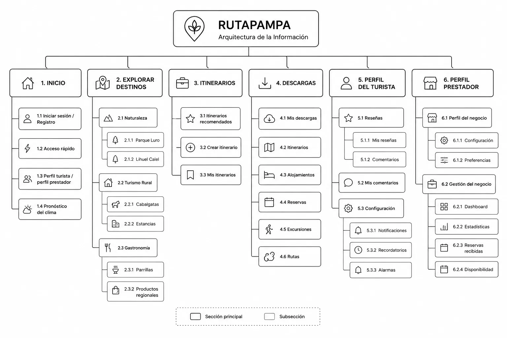

## The challenge

The province of La Pampa has a wide range of rural tourism options, but much of that information is scattered and barely digitized: each provider handles their own promotion, with no central channel where a tourist can compare options. This was the final exam for the User Interface Design course (School of Engineering, UNLPam), done individually in 3 hours: design RutaPampa, an app that would bring together rural tourism experiences —ranches, horseback rides, local food, guided tours— and let a tourist search, compare and plan their trip without relying on scattered sources.

With so little time, there was no room for field research like in [ASSIST](/en/projects/assist): the work went straight from the brief to the prototype, backed by the persona and the information architecture to keep design decisions consistent.

## Goals

The design had to let a tourist:

- Discover rural destinations.
- Search for experiences using filters.
- Create custom itineraries.
- Save content to view offline.
- Contact service providers.

## User Persona

**Carla**

*Tourist with an academic / professional profile*

Carla represents a different profile from the typical tourist. Her motivation comes from the academic and professional world: while trying to plan a trip, she notices how little of La Pampa's tourism information is digitized. That need becomes the project's design opportunity.

## Information architecture

The architecture organizes the app into six main sections —Home, Explore destinations, Itineraries, Downloads, Tourist profile and Provider profile—, clearly separating the features for each role. This structure kept navigation consistent throughout the design of the prototype.

## Prototype

### Sign-up

A single form lets you choose between a tourist or provider profile right from the start, with no separate flows.

### Exploration

A free-text search on the home screen plus a single panel of combinable filters: price, experience type, points of interest, dates and number of people.

### Results

Each experience shows its provider —name, photo, a short tagline— to build trust, and an empty state that always offers a next step.

### Itineraries

Ready-made routes put together by other travelers with an hour-by-hour timeline, plus the option to build your own from scratch.

## Design decisions

### Navigation

I used global navigation through a bottom bar present on every screen to guarantee constant access to the main features.

### Offline downloads

I added a dedicated downloads section to address the rural tourism context, where connectivity can be limited.

### Filters

All filters were grouped on a single screen to avoid multiple steps during search.

### Results

Each experience shows information about the provider to build more trust before making a booking.

### Empty states

Error messages always offer a next step, so the user is never left without options.

## UX Writing

| Situation | Microcopy |
| --- | --- |
| Onboarding | Where are you traveling? |
| No results | Sorry, try changing your date |
| Successful booking | Congratulations! Cabaña Los Álamos confirmed your booking |
| Empty state | What are you waiting for to plan your trip? |
| Push | Parapente Calel just posted new adventures |
| Placeholder | Ranches with an outdoor grill |

## What I learned

This project let me practice prioritizing features and making design decisions under a tight time constraint. Since it was a three-hour exam, I had to decide which features to develop in depth and which to address only through the information architecture.

## Next steps

If I continued the project, I would build out the full provider profile flow, adding:

- Publishing experiences
- Booking management
- Availability calendar
- Statistics dashboard
- Business management
