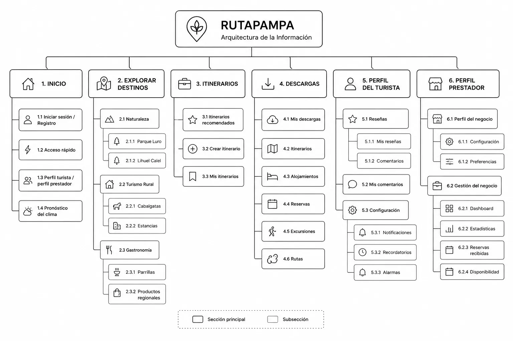

## El desafío

La provincia de La Pampa cuenta con una amplia oferta de turismo rural, pero gran parte de esa información se encuentra dispersa y poco digitalizada: cada prestador maneja su propia difusión, sin un canal centralizado donde un turista pueda comparar opciones. Este fue el examen final de la materia Diseño de Interfaces de Usuario (Facultad de Ingeniería, UNLPam), individual y a resolver en 3 horas: diseñar RutaPampa, una app que centralizara experiencias de turismo rural —estancias, cabalgatas, gastronomía local, visitas guiadas— y le permitiera a un turista buscar, comparar y organizar su viaje sin depender de fuentes dispersas.

Con ese tiempo acotado no había margen para investigación de campo como en [ASSIST](/proyectos/assist): el trabajo fue directo de la consigna al prototipo, apoyado en la persona y la arquitectura para mantener las decisiones de diseño consistentes.

## Objetivos

El diseño debía permitir que un turista pudiera:

- Descubrir destinos rurales.
- Buscar experiencias mediante filtros.
- Crear itinerarios personalizados.
- Guardar contenido para consultarlo sin conexión.
- Contactar prestadores de servicios.

## User Persona

**Carla**

*Turista con perfil académico / profesional*

Carla representa un perfil diferente al turista tradicional. Su motivación nace desde el ámbito académico y profesional: al intentar organizar un viaje detecta la escasa digitalización de la información turística de La Pampa. Esa necesidad se convierte en la oportunidad de diseño del proyecto.

## Arquitectura de la información

La arquitectura organiza la aplicación en seis secciones principales —Inicio, Explorar destinos, Itinerarios, Descargas, Perfil del turista y Perfil del prestador—, separando claramente las funcionalidades de cada rol. Esta estructura permitió mantener una navegación consistente durante todo el diseño del prototipo.

## Prototipo

### Registro

El mismo formulario permite elegir entre perfil turista o prestador desde el arranque, sin flujos separados.

### Exploración

Buscador libre en el inicio más un panel único de filtros combinables: precio, tipo de experiencia, lugares de interés, fechas y personas.

### Resultados

Cada experiencia muestra a su prestador —nombre, foto, frase descriptiva— para generar confianza, y un estado vacío que siempre ofrece una acción siguiente.

### Itinerarios

Circuitos ya armados por otros viajeros con línea de tiempo hora a hora, más la opción de crear uno propio desde cero.

## Decisiones de diseño

### Navegación

Se utilizó una navegación global mediante una barra inferior presente en todas las pantallas para garantizar acceso permanente a las funciones principales.

### Descargas offline

Se incorporó una sección específica de descargas para responder al contexto del turismo rural, donde la conectividad puede ser limitada.

### Filtros

Se agruparon todos los filtros en una única pantalla para evitar múltiples pasos durante la búsqueda.

### Resultados

Cada experiencia muestra información del prestador para generar mayor confianza antes de realizar una reserva.

### Estados vacíos

Los mensajes de error siempre ofrecen una acción siguiente, evitando que el usuario quede sin alternativas.

## UX Writing

| Situación | Microcopy |
| --- | --- |
| Onboarding | ¿Adónde viajas? |
| Sin resultados | Lo siento, intenta cambiar tu fecha |
| Reserva exitosa | ¡Felicidades! Cabaña Los Álamos confirmó tu reserva |
| Estado vacío | ¿Qué estás esperando para organizar tu viaje? |
| Push | Parapente Calel acaba de publicar nuevas aventuras |
| Placeholder | Estancias con parrilla al aire libre |

## Qué aprendí

Este proyecto me permitió practicar cómo priorizar funcionalidades y tomar decisiones de diseño bajo una restricción fuerte de tiempo. Al tratarse de un examen de tres horas, fue necesario definir qué funcionalidades desarrollar en profundidad y cuáles resolver únicamente desde la arquitectura de la información.

## Próximos pasos

Si continuara el proyecto, desarrollaría el flujo completo del perfil prestador incorporando:

- Publicación de experiencias
- Gestión de reservas
- Calendario de disponibilidad
- Panel de estadísticas
- Administración del negocio
